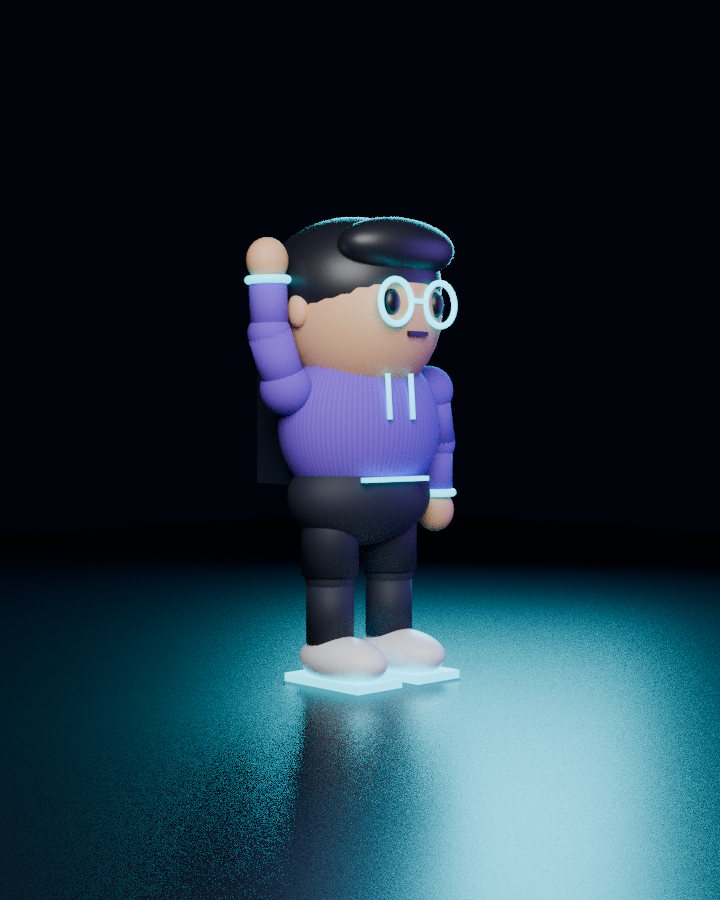
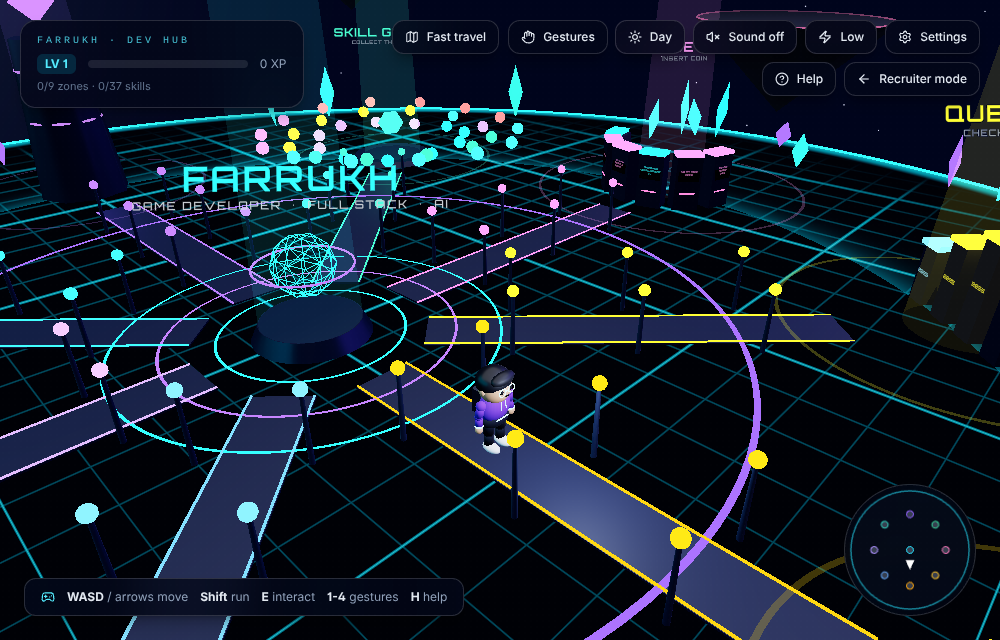
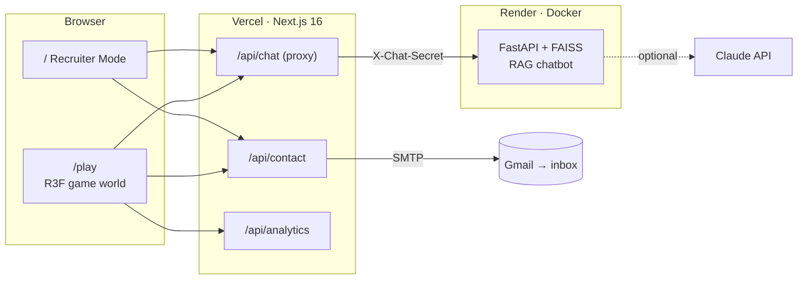
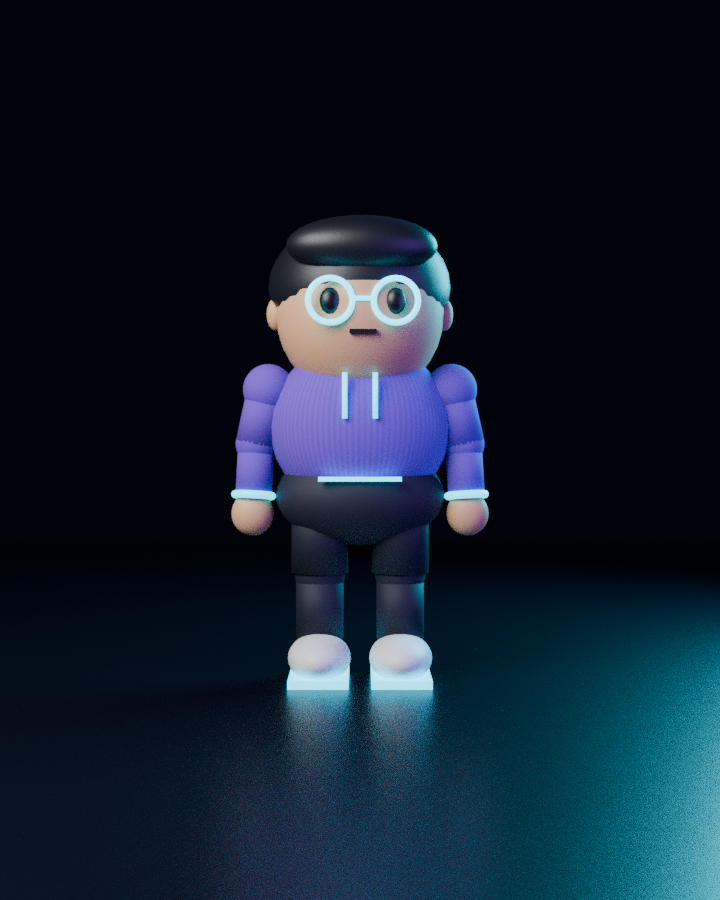
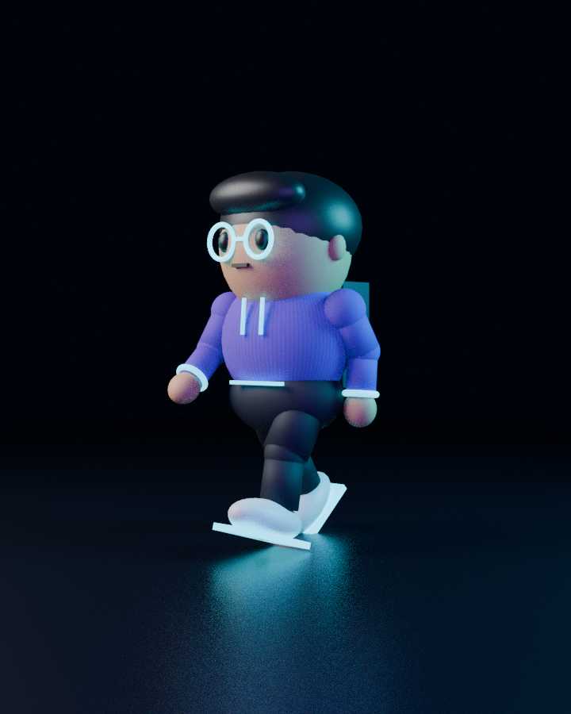
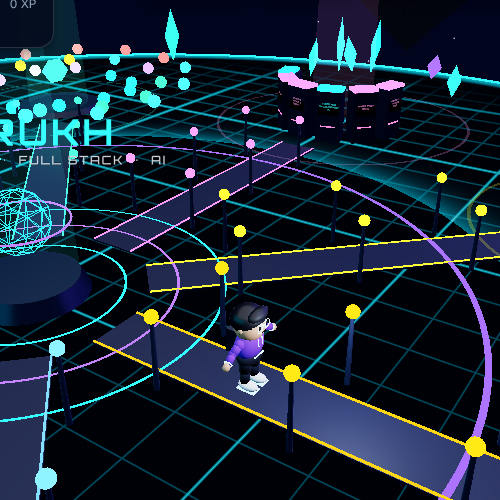
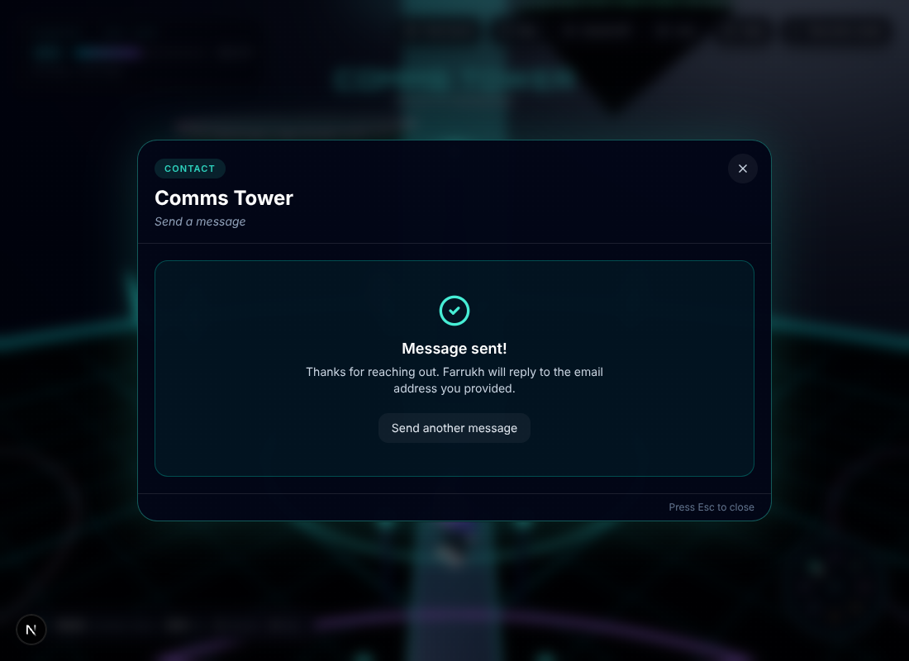

<div align="center">



# Farrukh · Dev Hub

### A portfolio you don't scroll — you *play*.

Walk a custom 3D avatar across a floating archipelago, step into buildings to explore my work, ask an AI that only tells the truth, and send me a message from a tower in the clouds.

<br />

[](https://YOUR-SITE.vercel.app/play)
[](https://YOUR-SITE.vercel.app)
[](https://YOUR-SITE.vercel.app/play)

<br />


</div>

<br />

<p align="center">
  
</p>

---

## ✦ The idea

Most portfolios are a wall of text with a hero image. This one is a **game world**.

You spawn on a plaza at the centre of a floating island archipelago. Glowing paths lead to eleven zones — each one a different part of my story. Walk there, press **E**, and the building opens a panel with real content: projects, skills, experience, certificates, a résumé, a chatbot, a contact form.

Earn XP, unlock achievements, collect skill orbs, watch the sky shift from day to night.

> Not a gamer? **Recruiter Mode** (`/`) serves the exact same content as a fast, classic scrolling page. Nobody is forced to play.

---

## ✦ Explore the world

| Zone | Tagline | What you'll find |
|---|---|---|
| 🏛️ **Spawn Plaza** | *Welcome, player one* | Introduction, profile and the player card |
| 🗼 **Origin Tower** | *The story so far* | Swipeable story chapters, toolbox of tags, a reactive 3D crystal |
| 🌳 **Skill Grove** | *Collect them all* | 37 skills as floating orbs that lift and swell as your cursor nears |
| 🕹️ **Arcade Hall** | *Insert coin* | Projects with filtering, search and ordering |
| 🛣️ **Quest Road** | *Checkpoints reached* | Education and experience as a timeline of checkpoints |
| 🏆 **Trophy Room** | *Achievements unlocked* | Certificates in a 3D carousel, plus your in-game achievements |
| ✈️ **Resume Hangar** | *Ready for takeoff* | Résumé and download |
| 🎬 **Promo Cinema** | *Now showing* | The 46-second promo video |
| 🔮 **Oracle Terminal** | *Ask me anything* | The RAG chatbot — English and Urdu, voice in and out |
| ⚓ **Hire Harbour** | *Let's build something* | Availability and ways to work together |
| 📡 **Comms Tower** | *Send a message* | A secured contact form that lands in my inbox |

---

## ✦ Features

### 🎮 The game layer
- **Custom Blender avatar** — modelled, rigged and exported by me. Idles, walks, runs, and performs four gestures: **Wave · Cheer · Bow · Think**.
- **Living world** — day/night cycle, cloud sea, waterfalls, floating islets, night stars, ambient audio and a minimap.
- **Smart camera rig** — orbit, zoom, and an automatic swing to face each zone you enter.
- **XP, achievements and beacons** — every zone visit and interaction counts.
- **Built for touch** — responsive virtual joystick with dead zone and eased curve, sprint button, pinch-to-zoom, haptics on supported phones, bottom-sheet panels, safe-area and landscape layouts.
- **Optimised for phones** — lower pixel ratio, fewer particles, no MSAA, instanced geometry for lit windows.

### 🤖 The Oracle — a chatbot that refuses to guess
A retrieval-augmented assistant that answers **only** from my real portfolio data.

```
Website data ─► Chunk (~75) ─► Embed ─► FAISS index ─► Retrieve + re-rank ─► LLM
                                                           │
                                         below threshold ──┴──► "I don't know." (LLM never called)
```

- Right chunk in the top 4 for **26/26** test questions; **12/12** out-of-scope questions refused (offline embedder, no LLM).
- Prompt-injection filter, input sanitising, per-IP rate limiting and a shared secret between site and backend.
- **Source chips** on every answer — click one and the avatar flies to the cited zone.
- Works offline with a hashed-vector embedder; upgrades to MiniLM embeddings and Claude answers when configured.

### ✉️ A contact system built like production software
- One **shared Zod schema** validates in the browser *and* again on the server.
- **Nodemailer over SMTP**, credentials server-side only; the visitor is set as `Reply-To`.
- Spam defence: invisible **honeypot**, **HMAC-signed time-trap token**, per-IP rate limits, link and duplicate checks, origin check, header-injection rejection, HTML escaping, 10 KB body cap, no personal data in logs.
- Verified by tests including a real SMTP round trip.

### ♿ Accessibility and privacy
- Reduced motion, high contrast, larger text, sound controls and reset in **Settings**.
- Skip link, focus-trapped dialogs, ARIA labels throughout.
- **Cookieless, anonymous analytics** that honour Do Not Track, with an in-app opt-out and a private `/stats` dashboard.

---

## ✦ Controls

| Input | Action |
|---|---|
| `W` `A` `S` `D` | Move |
| `Shift` | Run |
| `E` | Open the zone you're standing in |
| `←` `→` | Orbit camera |
| `↑` `↓` | Zoom camera |
| `1` `2` `3` `4` | Wave · Cheer · Bow · Think |
| `C` | Reset camera |
| `H` | Help |
| `Esc` | Close a panel |
| 📱 **Touch** | Joystick to walk, button to sprint, drag to orbit, pinch to zoom |

---

## ✦ Architecture



The browser never sees the chatbot URL, the shared secret, SMTP credentials or any API key.

| Layer | Technology |
|---|---|
| 3D | Three.js · React Three Fiber · drei · postprocessing |
| App | Next.js 16 (App Router) · React 19 · TypeScript · Tailwind CSS 4 |
| Motion | Framer Motion · GSAP · Lenis |
| State | Zustand |
| Validation | Zod |
| Chatbot | Python · FastAPI · FAISS · sentence-transformers (optional) · Claude API (optional) |
| Email | Nodemailer (SMTP) |
| Assets | Blender → GLB · After Effects / FFmpeg → MP4 |
| Hosting | Vercel (site) · Render (chatbot) |

---

## ✦ Getting started

### Prerequisites
- Node.js 20+
- Python 3.11+ *(only for the chatbot backend)*

### 1 · Run the site

```bash
git clone https://github.com/farrukhh31/farrukh-portfolio.git
cd farrukh-portfolio
npm install
cp .env.example .env.local      # then fill in the values below
npm run dev
```

Open **http://localhost:3000/play** for the game, or **http://localhost:3000** for Recruiter Mode.

### 2 · Run the chatbot *(optional)*

```bash
cd backend
python -m venv .venv && source .venv/bin/activate   # Windows: .venv\Scripts\activate
pip install -r requirements.txt
uvicorn app.main:app --reload --port 8000
```

Then point the site at it with `CHAT_API_URL=http://localhost:8000`.

> Rebuild the knowledge base from the site's data files any time with `node scripts/export-knowledge.mjs`.

### 3 · Test mail locally without a real inbox

```bash
npm run mail:capture     # starts a local SMTP capture server
```

### Environment variables

| Variable | Purpose |
|---|---|
| `CHAT_API_URL` | URL of the chatbot service (no trailing slash) |
| `CHAT_SHARED_SECRET` | Shared secret — must match the backend |
| `CONTACT_SECRET` | Signs the anti-spam time-trap tokens |
| `CONTACT_TO` / `CONTACT_FROM` | Where messages are delivered / sent from |
| `CONTACT_TRANSPORT` | `smtp` |
| `SMTP_HOST` · `SMTP_PORT` · `SMTP_SECURE` | e.g. `smtp.gmail.com` · `465` · `true` |
| `SMTP_USER` · `SMTP_PASS` | SMTP login (a Gmail **app password**, never your real one) |
| `ANALYTICS_KEY` | ≥ 12 chars; unlocks `/stats?key=…` |
| `CONTACT_ALLOWED_ORIGINS` | Only needed with a custom domain |

Generate strong secrets with:

```bash
node -e "console.log(require('crypto').randomBytes(32).toString('hex'))"
```

---

## ✦ Scripts

| Command | Does |
|---|---|
| `npm run dev` | Start the dev server |
| `npm run build` · `npm start` | Production build and serve |
| `npm test` | Run the Vitest suite |
| `npm run lint` | ESLint |
| `npm run mail:capture` | Local SMTP capture server |
| `npm run avatar:fbx` | Convert the avatar GLB to FBX via Blender |

---

## ✦ Testing

| Suite | Coverage |
|---|---|
| **Web** (Vitest) | Contact schema, SMTP round trip, spam rules and route · analytics events and route · layout · chat · avatar gestures verified against the real GLB's bones |
| **Backend** (Pytest) | Chunking, retrieval, refusal calibration, safeguards |
| **Static** | `tsc --noEmit` and ESLint in CI |

CI runs types, lint, tests, build and backend tests on every push.

---

## ✦ Deployment

Two services, about twenty minutes:

1. **Chatbot → Render** — *New → Blueprint*, pick this repo. [`render.yaml`](render.yaml) does the rest.
2. **Site → Vercel** — import the repo, add the environment variables above, deploy.
3. Set `CORS_ORIGINS` on Render to your Vercel URL.

Full step-by-step with a verification checklist and troubleshooting table: **[`docs/DEPLOYMENT.md`](docs/DEPLOYMENT.md)**.

> Free Render instances sleep when idle — the first Oracle question after a quiet period can take 30–60 s. Wake it before a demo.

---

## ✦ Project structure

```
farrukh-portfolio/
├── app/                  # Routes: / (Recruiter Mode), /play, /tour, /stats, /api/*
├── components/
│   ├── game/             # 3D world, avatar, HUD, minimap, zone panels
│   ├── chat/             # Oracle chatbot UI, voice, markdown
│   ├── Skills · Projects · certificates · About · hero …   # Recruiter Mode sections
│   └── ui/               # Shared primitives
├── lib/
│   ├── game/             # Zones, layout, input, audio, gestures, achievements, store
│   ├── contact/          # Schema, mailer, spam protection
│   └── analytics/        # Cookieless counters and events
├── backend/              # FastAPI RAG service + knowledge base + tests
├── avatar/               # Blender source and generator script
├── video/                # Storyboard, After Effects build script, render pipeline
├── docs/                 # Deployment, contact system, report, evidence
├── scripts/              # Knowledge export, SMTP capture
└── tests/                # Vitest suites
```

More docs: [`docs/CONTACT.md`](docs/CONTACT.md) · [`docs/PROJECT_REPORT.md`](docs/PROJECT_REPORT.md) · [`video/storyboard.md`](video/storyboard.md)

---

## ✦ Behind the scenes

<table>
  <tr>
    <td align="center"><br /><sub><b>Idle</b></sub></td>
    <td align="center"><br /><sub><b>Walk cycle</b></sub></td>
    <td align="center"><br /><sub><b>Cheer, in-game</b></sub></td>
    <td align="center"><br /><sub><b>Contact flow</b></sub></td>
  </tr>
</table>

---

## ✦ Roadmap

- [ ] Multiplayer — see other visitors walking the island
- [ ] CV-upload ingest page for the chatbot
- [ ] Strict Content-Security-Policy (needs browser testing alongside Three.js)
- [ ] Automated accessibility audit with `axe-core`
- [ ] Durable analytics storage

---

## ✦ Connect

<p align="center">
  <a href="https://github.com/farrukhh31"></a>
  <a href="https://www.linkedin.com/in/farrukh-ahmed-248356246"></a>
</p>

<p align="center">
  <sub>Built with Three.js, a lot of Blender, and too much coffee.<br />
  If you enjoyed the world, a ⭐ on the repo means a lot.</sub>
</p>
