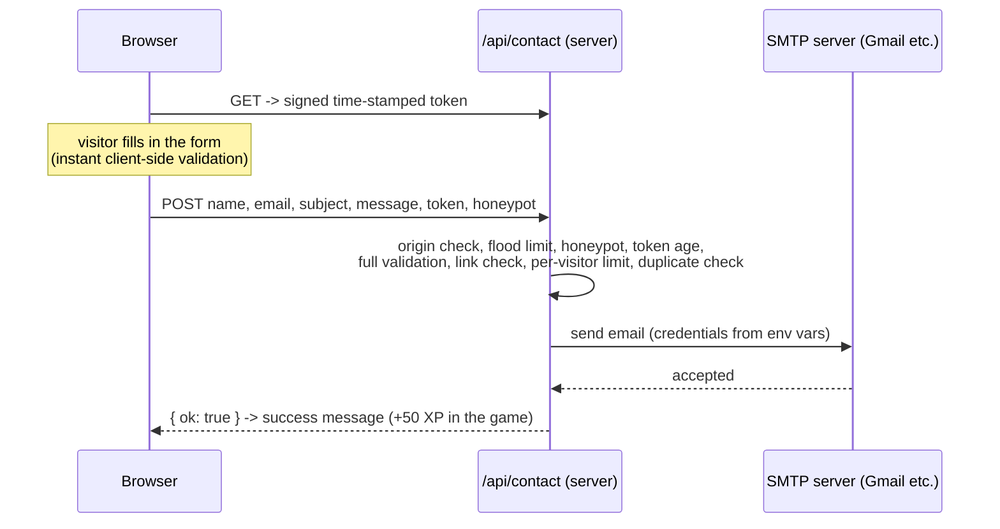

# Contact system (Module 5)

Visitors can email Farrukh from two places: the **Comms Tower** in the game (`/play`) and the contact
section of **Recruiter Mode** (`/`). Both post to the same endpoint, `app/api/contact/route.ts`.

## How it works



## Requirement checklist

| Requirement | Where |
|---|---|
| Form: name, email, subject, message | `components/game/panels/CommsPanel.tsx`, `components/contact/contactForm.tsx` (its "purpose" dropdown is the subject) |
| Validation on **frontend** | zod schema shared with the server (`lib/contact/schema.ts`): per-field errors on blur and on submit, focus moves to the first error, `aria-invalid` + `aria-describedby` |
| Validation on **backend** | same schema re-run on the server; the browser is never trusted |
| Sends to the designated address | `lib/contact/mailer.ts` (nodemailer) -> `CONTACT_TO`; the visitor is set as **Reply-To**, so you just hit Reply |
| Success and error messages | success card / inline errors; clear text for 400, 429, 502, 503 and network failure |
| Credentials in environment variables | `SMTP_*`, `CONTACT_*` are read only on the server (see `.env.example`); nothing is in the code or sent to the browser |
| Spam protection | see below |
| Secure handling of input | see below |

## Spam protection

1. **Honeypot** - an invisible field (off-screen, `aria-hidden`, not focusable). If filled, the server answers "success" and silently drops the message, so bots learn nothing.
2. **Time trap** - the server issues an HMAC-signed timestamp token. Submissions faster than 3 s, older than 2 h, or with a forged token are rejected. Stateless, so it works on serverless hosting.
3. **Rate limiting** - per visitor IP: 3 emails / 10 min and 10 / day (only valid messages count, so typos never lock anyone out), plus a loose 30 requests / min flood guard.
4. **Content checks** - more than 2 links is rejected; an identical resend within an hour is delivered only once.
5. **Origin check** - cross-site browser posts are rejected (`403`).

## Secure input handling

* Name, email and subject **reject CR/LF** (email header injection); control characters are stripped; Unicode is normalised.
* Display names are stripped of header-breaking characters; the visitor's email is validated before it is used as Reply-To.
* The HTML version of the email **escapes** everything (no markup injection into your inbox).
* Request body capped at 10 KB; fields capped (name 80, subject 120, message 2000).
* Errors returned to the browser never include server details; message text, names and emails are never logged.

## Setup

1. Copy `.env.example` to `.env.local` and fill in the **Contact form** section.
2. **Gmail:** turn on 2-step verification, create an *App password* (Google Account -> Security -> App passwords), then:
   ```
   CONTACT_TRANSPORT=smtp
   SMTP_HOST=smtp.gmail.com
   SMTP_PORT=465
   SMTP_SECURE=true
   SMTP_USER=you@gmail.com
   SMTP_PASS=<the 16-character app password>
   CONTACT_FROM=you@gmail.com
   CONTACT_TO=you@gmail.com
   CONTACT_SECRET=<random 32+ characters>
   ```
3. `npm run dev`, open `/play`, walk to the Comms Tower (or open Recruiter Mode) and send a test message.
4. **On the host (e.g. Vercel):** add the same variables in the project's *Environment Variables* settings. Never commit `.env.local`.

### Testing without any mail account
```bash
npm run mail:capture          # starts a local SMTP server on 127.0.0.1:2525 that prints every email
# .env.local:  CONTACT_TRANSPORT=smtp  SMTP_HOST=127.0.0.1  SMTP_PORT=2525  SMTP_SECURE=false
#              CONTACT_TO=me@example.com  CONTACT_FROM=site@example.com  CONTACT_SECRET=...
```
Or set `CONTACT_TRANSPORT=file` and every message is saved as an `.eml` file in `.contact-outbox/`.

## Evidence of delivery

`docs/evidence/` contains:
* `70`-`73-*.png` - screenshots of the empty form, validation errors, the filled form, and the success message.
* `email-received-recruiter-form.eml` - the exact email received by an SMTP server after a visitor used the Recruiter Mode form (open it in any mail client or text editor).

**Important:** these were produced against a *local* SMTP server, which proves the whole pipeline (form -> validation -> spam checks -> SMTP delivery with authentication). For your report, repeat step 3 above with your real Gmail settings and add a screenshot of the message arriving in your actual inbox - that is the evidence your instructor will most likely look for.

## Tests

```bash
npm test        # 41 tests, ~3 s
```
Schema rules, header injection, token forging/expiry/too-fast, rate limits (including "typos don't count" and flood guard), honeypot, link stuffing, duplicate sends, cross-site posts, oversized/malformed bodies, HTML escaping, safe errors when the mail server is down, and a **real SMTP round trip** (authenticated delivery to an in-process SMTP server, plus a wrong-password failure that leaks nothing).
