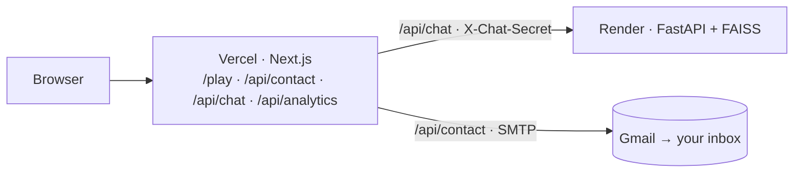

<div align="center">

# 🚀 Deployment Guide

**Ship the playable portfolio in about 20 minutes.**


</div>

Two pieces are deployed: the **Next.js site** (Vercel) and the **Python chatbot** (Render, via Docker). This needs your own accounts, so this file is the exact recipe.



> [!NOTE]
> The browser never sees the chatbot service URL, the shared secret, SMTP credentials or any API key.

## Contents

- [0 · Before you start](#0--before-you-start)
- [1 · Chatbot on Render](#1--chatbot-on-render)
- [2 · Website on Vercel](#2--website-on-vercel)
- [3 · Verify](#3--verify)
- [Troubleshooting](#troubleshooting)
- [Alternative: one machine](#alternative-one-machine)

## 0 · Before you start

1. Push the project to GitHub. `.env.local` is git-ignored; `.env.example` is tracked.
2. Make a Gmail **App password**: Google Account → Security → turn on 2-Step Verification → App passwords.
3. Generate three different secrets:
   ```bash
   node -e "console.log(require('crypto').randomBytes(32).toString('hex'))"
   ```

## 1 · Chatbot on Render

1. Render dashboard → **New → Blueprint** → choose the repo (it reads `render.yaml`).
2. Fill in when asked:
   - `CHAT_SHARED_SECRET`: secret #1
   - `ANTHROPIC_API_KEY`: optional
   - `CORS_ORIGINS`: set after step 2; editable later
3. Wait for the build, then open `https://<service>.onrender.com/api/health`. It should respond OK.
4. Note the service URL.

> [!TIP]
> Free Render instances sleep when idle, so the first question after a quiet period can take **30–60 s**. Wake the service before a demo.
> Without `ANTHROPIC_API_KEY` the bot still works, but it quotes your documents instead of writing sentences.

## 2 · Website on Vercel

1. Vercel → **Add New → Project** → import the repo (framework: Next.js, nothing to change).
2. Add these **Environment Variables** (Production):

| Name | Value |
|---|---|
| `CHAT_API_URL` | the Render URL from step 1 (no trailing slash) |
| `CHAT_SHARED_SECRET` | same as on Render |
| `CONTACT_SECRET` | secret #2 |
| `CONTACT_TO`, `CONTACT_FROM` | your Gmail address |
| `CONTACT_TRANSPORT` | `smtp` |
| `SMTP_HOST` / `SMTP_PORT` / `SMTP_SECURE` | `smtp.gmail.com` / `465` / `true` |
| `SMTP_USER` / `SMTP_PASS` | your Gmail / the 16-character app password |
| `ANALYTICS_KEY` | secret #3 (≥ 12 chars), used for `/stats?key=…` |
| `CONTACT_ALLOWED_ORIGINS` | only if you add a custom domain, e.g. `https://yourname.dev` |

3. **Deploy.** Then set `CORS_ORIGINS` on Render to your Vercel URL.
4. Vercel project → **Analytics → Enable** for durable page-view history (the built-in counters reset between serverless instances).

## 3 · Verify

Screenshot each item for the report.

- [ ] `/play` loads, the avatar is visible, you can walk and open zones; `/` loads
- [ ] Oracle Terminal answers *"What projects has Farrukh built?"* with source chips and refuses *"What is his salary?"*
- [ ] Contact form → success message → **the email arrives in your inbox** (this is the evidence the brief asks for)
- [ ] Promo video plays in Promo Cinema
- [ ] `/stats?key=<ANALYTICS_KEY>` shows counters
- [ ] On a phone: joystick appears, layout fits
- [ ] `curl -I <url>/play` shows `X-Frame-Options` and `X-Content-Type-Options`

## Troubleshooting

| Symptom | Likely cause |
|---|---|
| Oracle says it is offline | `CHAT_API_URL` wrong, Render asleep (retry), or the two secrets differ |
| Contact: "could not send" (502/503) | Wrong app password, or `SMTP_*` / `CONTACT_*` missing on Vercel. Check Function logs |
| Contact: 403 | Site opened from a domain not in `CONTACT_ALLOWED_ORIGINS` |
| `/stats` unauthorised | `ANALYTICS_KEY` missing, or the key in the URL differs |
| Env change has no effect | Redeploy after editing Vercel variables |

## Alternative: one machine

The backend has a `Dockerfile`. Run the site with `npm run build && npm start` and put both behind any reverse proxy.
