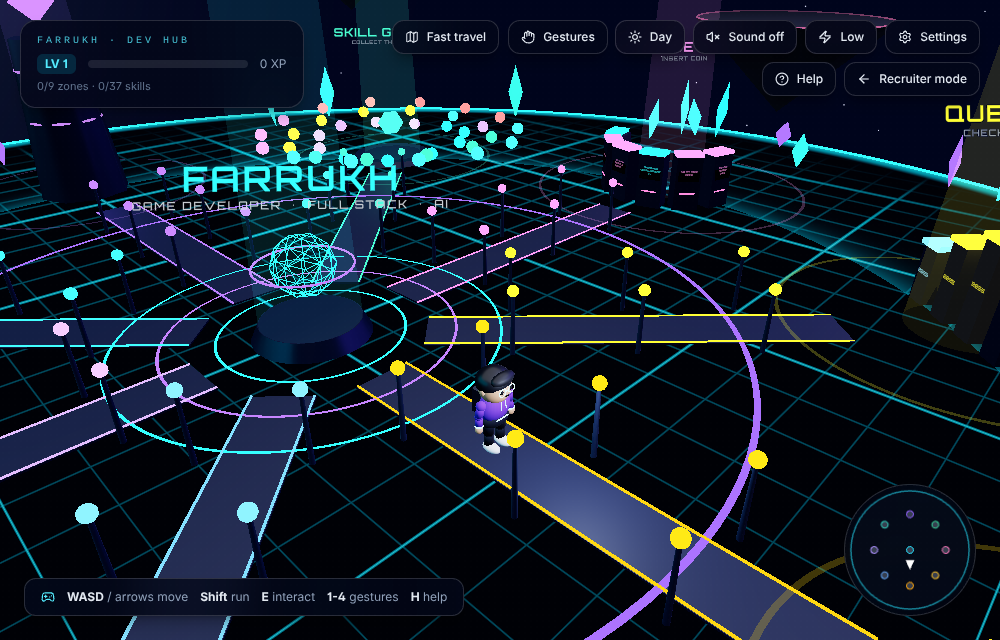
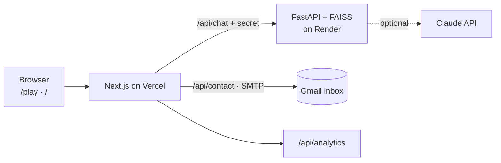
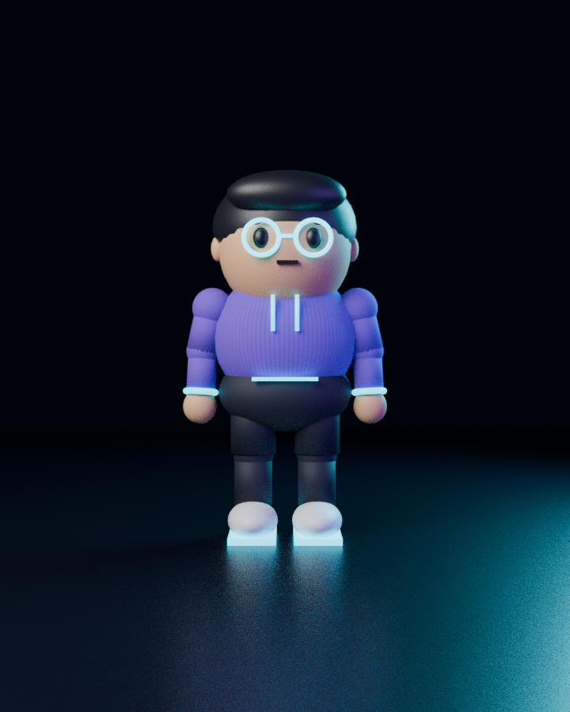
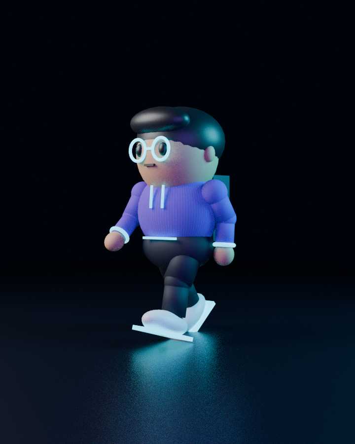
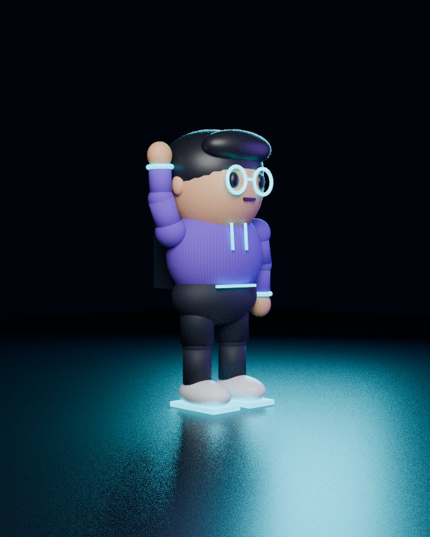
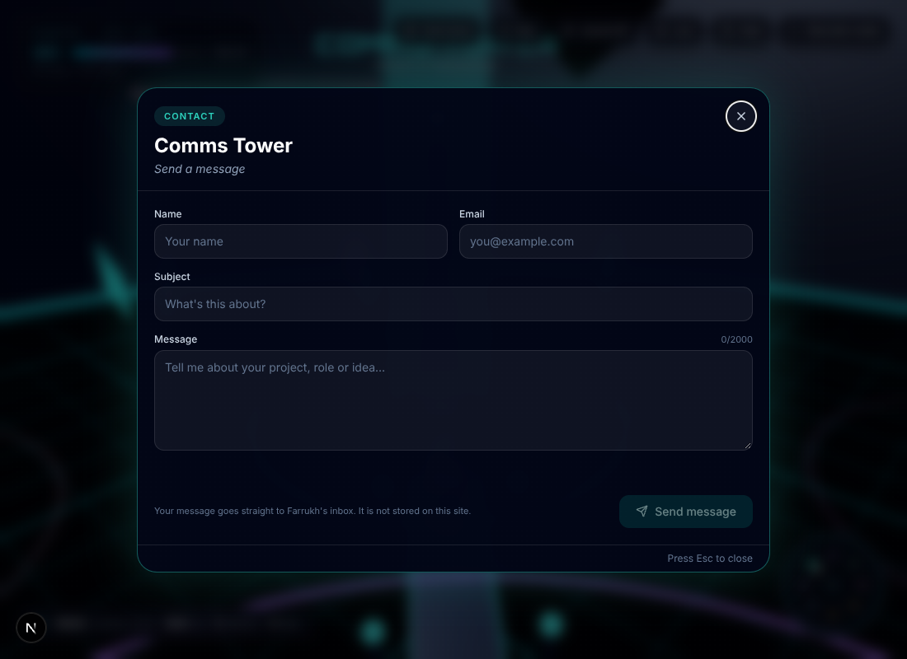
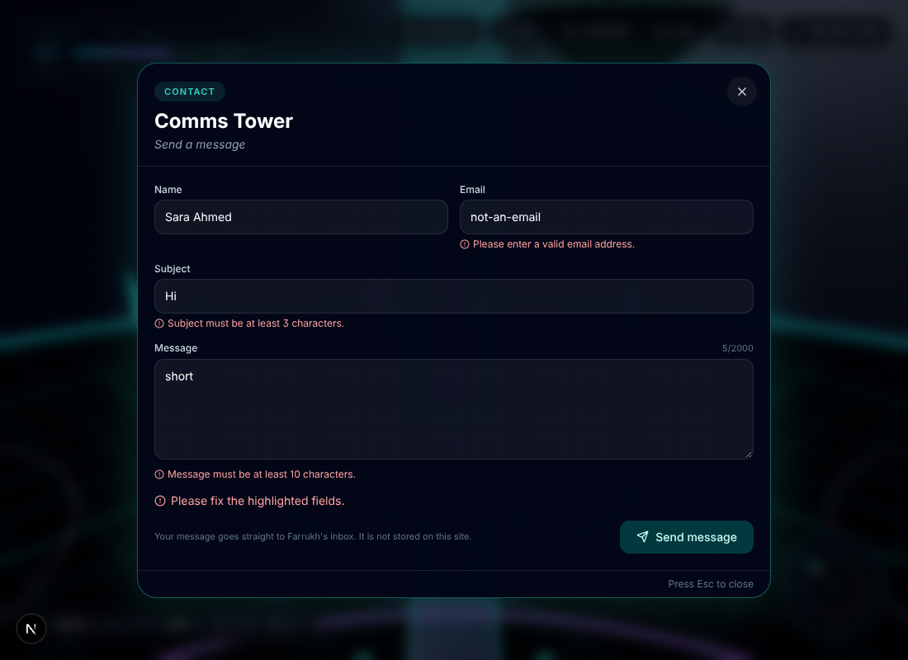
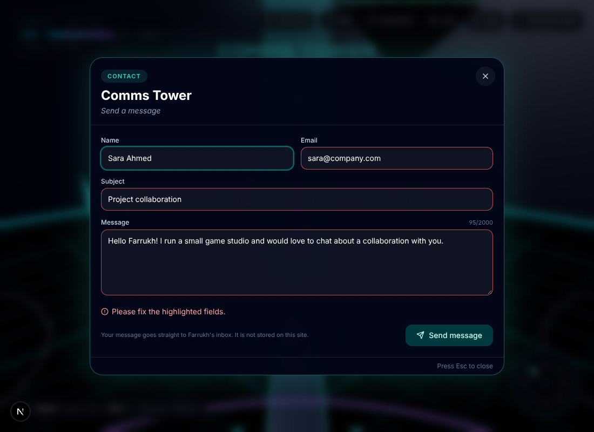
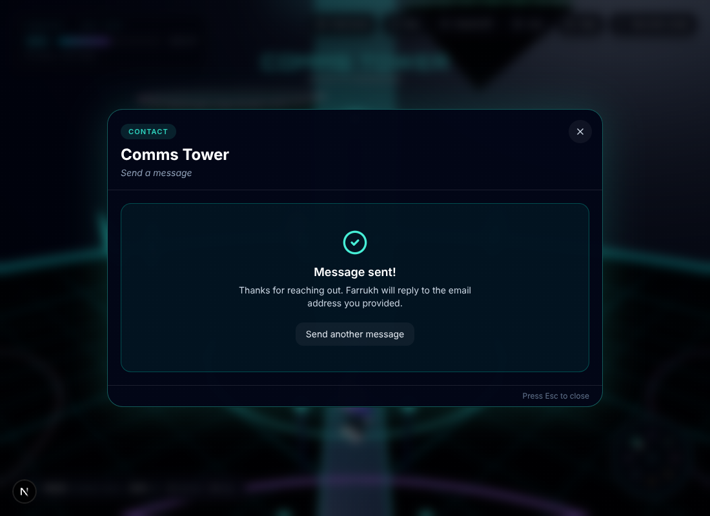

# 📘 Project Report

## Farrukh · Dev Hub — a Playable 3D Web Portfolio

**Course** Web3D Programming (Three.js) &nbsp;·&nbsp; **Student** Farrukh &nbsp;·&nbsp; **Date** `____`

[**Live site**](https://YOUR-SITE.vercel.app) &nbsp;·&nbsp; [**Repository**](https://github.com/farrukhh31/farrukh-portfolio) &nbsp;·&nbsp; [**Deployment guide**](DEPLOYMENT.md)

> [!NOTE]
> Fill in the `____` blanks and add screenshots where marked **[SHOT]**.

## Contents

1. [Overview](#1-overview)
2. [Architecture](#2-architecture)
3. [Module by module](#3-module-by-module)
4. [Extra-credit features](#4-extra-credit-features)
5. [Testing](#5-testing)
6. [Known limitations](#6-known-limitations)
7. [What I learned and future work](#7-what-i-learned-and-future-work)
8. [References](#8-references)

---

## 1. Overview

The project turns a conventional portfolio into a **playable 3D world**. A custom Blender avatar walks around a low-poly island; each of the buildings (*zones*) holds one part of the portfolio. Visitors collect XP, unlock achievements, talk to an AI chatbot at the **Oracle Terminal** and send me email from the **Comms Tower**.

A normal scrolling page, **Recruiter Mode** (`/`), is kept for visitors who prefer it. Both modes serve the same content.

| | |
|---|---|
| 🎮 **Play** | `/play`: the 3D world |
| 📄 **Recruiter Mode** | `/`: classic scrolling portfolio |
| 📊 **Stats** | `/stats?key=…`: private analytics dashboard |

## 2. Architecture

| Layer | Technology | Role |
|---|---|---|
| 3D game | Three.js via React Three Fiber, drei, postprocessing | Island, avatar, camera rig, effects |
| UI | Next.js 16 (App Router), React 19, TypeScript, Tailwind 4, Framer Motion | HUD, panels, Recruiter Mode |
| State | Zustand | XP, visited zones, achievements, settings |
| Server routes | Next.js route handlers | `/api/contact`, `/api/chat` (proxy), `/api/analytics` |
| Chatbot | Python, FastAPI, FAISS, optional Claude API | Retrieval-augmented answers |
| Assets | Blender → GLB; After Effects / FFmpeg → MP4 | Avatar and promo video |
| Hosting | Vercel (site) + Render (chatbot, Docker) | See [DEPLOYMENT.md](DEPLOYMENT.md) |

## 3. Module by module

### Module 1 · 3D web portfolio

The world has **11 zones**, including Spawn Plaza, Origin Tower (About), Skill Grove (37 skills), Arcade Hall (projects with filtering and ordering), Quest Road (education and experience timeline), Trophy Room (certificates and achievements), Promo Cinema (video), Oracle Terminal (chatbot) and Comms Tower (contact).

Also included: day/night cycle, minimap, HUD, ambient audio, a camera that swings to face each zone, and a virtual joystick on touch devices. Layouts are responsive across desktop, tablet and phone. Recruiter Mode provides the same content as a classic page.

**[SHOT]** `/play` desktop · `/play` mobile · `/`

### Module 2 · Blender avatar

An original character modelled and rigged in Blender (`avatar/farrukh-avatar.blend`, generated by `avatar/build_avatar.py`), with materials and colours applied, exported as `public/models/avatar.glb` (about 1.2 MB).

In the game it idles, walks, runs and performs four gestures: **Wave, Cheer, Bow, Think**. The gesture poses are unit-tested against the real GLB's bones.

<table>
  <tr>
    <td align="center"> Idle</td>
    <td align="center"> Walk</td>
    <td align="center"> Wave</td>
  </tr>
</table>

**[SHOT]** Blender viewport

### Module 3 · Promo video

A 46-second 16:9 video: intro, avatar, world, skills, projects, journey, "under the hood", outro. The storyboard and the After Effects build script are in [`video/`](../video/storyboard.md). The music is original, generated by `video/render_promo.py`, so there is no licensing issue. The MP4 embedded in Promo Cinema is `public/videos/promo.mp4`.

> [!IMPORTANT]
> The shipped MP4 was rendered from the script pipeline (`video/render_promo.py`). The `.aep` must be produced by running `video/build_promo_comp.jsx` in After Effects (see the storyboard).

**[SHOT]** After Effects timeline

### Module 4 · RAG chatbot

| Step | What happens |
|---|---|
| **1 · Collect** | The site's data files are exported to `backend/knowledge/*.md` (profile, about, skills, projects, experience, certificates). A CV can be added. |
| **2 · Chunk** | One chunk per project, skill, job or certificate, with a context prefix (about 75 chunks). Long sections are windowed with overlap. |
| **3 · Embed** | MiniLM sentence embeddings if installed, otherwise a BM25-weighted hashed-vector embedder that works offline. |
| **4 · Store** | FAISS inner-product index (NumPy fallback). |
| **5 · Retrieve** | Top-k plus a heading-aware re-rank. The answer/refuse decision uses raw similarity. |
| **6 · Generate** | The LLM answers only from retrieved chunks. Below the similarity threshold the model is **not called** and the bot says it does not know. |

**Safeguards:** prompt-injection filter, input sanitising, per-IP rate limit, shared secret between site and backend, third-person answers, source chips.
**Extras:** Urdu, voice input and output, citations that fly the avatar to the cited zone.

| Measured (offline embedder, no LLM) | Result |
|---|---|
| Right chunk in top 4 | **26 / 26** questions |
| Right chunk ranked first | **22 / 26** |
| Out-of-scope questions refused | **12 / 12** |
| Backend tests | **53 passing** |

> [!NOTE]
> Real Claude answers and MiniLM retrieval were **not** measured (no API key or model download in the build environment). Re-run `python -m tests.calibrate` after enabling them.

### Module 5 · Contact system

A form with name, email, subject (purpose) and message. One shared **zod** schema validates in the browser and again on the server. Mail is sent with **Nodemailer over SMTP** using credentials from environment variables (never sent to the browser); the visitor's address is set as `Reply-To`.

**Spam and security:** honeypot field, HMAC-signed time-trap token, per-IP rate limits, link and duplicate checks, origin check, header-injection rejection, HTML escaping, 10 KB body cap, no personal data in logs. **41 tests**, including a real SMTP round trip.

**Evidence:** `docs/evidence/70-73-*.png` and `email-received-recruiter-form.eml` (local SMTP). Full details in [CONTACT.md](CONTACT.md).

<table>
  <tr>
    <td> Empty</td>
    <td> Validation</td>
    <td> Filled</td>
    <td> Sent</td>
  </tr>
</table>

> [!IMPORTANT]
> Add a screenshot of a message arriving in your **real inbox** after deployment.

### Module 6 · Deployment and documentation

[`DEPLOYMENT.md`](DEPLOYMENT.md) (step by step), `render.yaml` (chatbot blueprint), GitHub Actions CI (types, lint, tests, build, backend tests), plus security headers and asset caching in `next.config.ts`.

Documentation: this report, `README.md`, [`CONTACT.md`](CONTACT.md), `video/storyboard.md`.

## 4. Extra-credit features

| Feature | Implementation |
|---|---|
| 🖱️ Mouse-reactive 3D objects | Skill orbs near the pointer lift, swell and show their name |
| 🌗 Dark / light | Day-night cycle and theme toggle |
| 🎙️ Voice interaction | Web Speech API input and spoken answers |
| 🌍 Multilingual chatbot | English and Urdu |
| 🕺 Avatar gestures | Wave, Cheer, Bow, Think (keys 1–4 or HUD) |
| 🔎 Project filtering, search and ordering | Arcade Hall |
| 📈 Analytics | Anonymous cookieless counters, `/stats` dashboard, honours Do Not Track, opt-out in Settings, Vercel Analytics for durable views |
| ♿ Accessibility | Settings (reduced motion, high contrast, larger text, sound, reset), skip link, focus-trapped dialogs, ARIA labels |
| 📎 Citations | Source chips on every chatbot answer |

## 5. Testing

| Suite | Result |
|---|---|
| Web unit tests (`npm test`) | ✅ 79 passing (contact 41, analytics 29, avatar gestures 9, checked against the real GLB) |
| Chatbot tests (`pytest`) | ✅ 53 passing |
| TypeScript (`tsc --noEmit`) | ✅ clean |
| ESLint | ⚠️ 0 errors, 23 warnings (legacy Recruiter Mode components, see below) |
| Production build | ✅ passes |

## 6. Known limitations

> [!WARNING]
> Be upfront about these in the viva.

- Gesture animations, the Settings dialog, high-contrast mode, orb hover and the `/stats` page were verified by tests and code review, **not yet by eye** in a full browser. Check them before the demo.
- No automated accessibility audit has been run (`axe-core` is installed for that purpose), so no score is claimed.
- In-memory analytics counters reset between serverless instances; durable views come from Vercel Analytics.
- Real-inbox email delivery must be demonstrated after deployment with your Gmail app password.
- Free-tier chatbot hosting sleeps when idle.
- Lint: the 23 warnings are React 19 strict-rule notices (setState in effects, impure render) in the original Recruiter Mode components. They work, but should be refactored to `useSyncExternalStore` or derived state.
- No strict Content-Security-Policy yet (needs browser testing with Three.js).

## 7. What I learned and future work

> [!TIP]
> Write 4–6 lines in your own words. Ideas: GLB export and rigging pitfalls, R3F performance (instancing, draw calls), designing a RAG system that **refuses instead of guessing**, and what you would add next (multiplayer, a CV-upload ingest page, CSP).

## 8. References

Three.js, React Three Fiber, drei and Next.js docs · Blender manual · FAISS · sentence-transformers (`all-MiniLM-L6-v2`) · Anthropic API docs · Web Speech API (MDN). *Add the exact links you used.*
